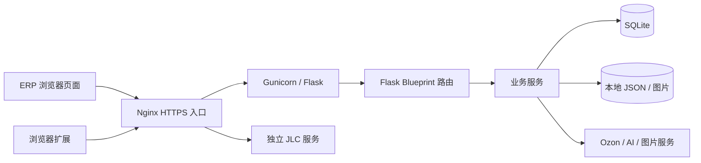

# GeekOzon ERP 基础架构

这份说明根据仓库代码和运行服务器的只读核对编写。它解释各层如何连接，也标明公开仓库与实际部署的边界。仓库是分批整理的学习版本，不能把某个文件的存在理解成对应业务已经过线上验证。

## 从浏览器到数据

运行服务器上，Nginx 负责 HTTPS 入口，ERP 由 Gunicorn 承载 Flask 应用。JLC 是独立进程，经反向代理接入页面；其完整源码没有进入本仓库。图中画的是进程关系，不代表这些外部服务都能在下载仓库后直接使用。

## 代码按职责分工

| 层 | 入口和职责 | 接着读什么 |
|---|---|---|
| 页面装配 | [`frontend/index.html`](../frontend/index.html) 按顺序加载样式、共享脚本、页面脚本和 `app.js` | 页面脚本位于 `frontend/js/pages/` |
| 前端启动与导航 | [`frontend/js/app.js`](../frontend/js/app.js) 先检查登录，再初始化组件和路由；[`frontend/js/router.js`](../frontend/js/router.js) 根据 `#/路径` 切换页面 | 每个页面文件底部的 `Router.register(...)` |
| 请求层 | [`frontend/js/api.js`](../frontend/js/api.js) 统一发起 HTTP 请求、带上登录令牌并处理超时及常见错误 | 页面调用的具体 `Api` 方法 |
| 应用装配 | [`backend/app.py`](../backend/app.py) 创建 Flask 应用，初始化数据库、注册全局认证和蓝图，提供前端静态文件及少量共享接口 | `create_app()` |
| HTTP 接口 | [`backend/routes/__init__.py`](../backend/routes/__init__.py) 注册蓝图；`backend/routes/` 中的文件读取参数、检查权限并返回结果 | 对应路由函数 |
| 业务处理 | `backend/services/` 保存定价、订单、财务、上架和外部 API 调用等逻辑 | 路由导入的服务函数 |
| 数据访问 | [`backend/db.py`](../backend/db.py) 管理 SQLite 连接和旧库迁移；[`backend/schema.sql`](../backend/schema.sql) 定义新库表结构；`backend/models/` 封装领域数据 | 表名、模型方法与数据归属 |
| 配置与权限 | [`backend/config.py`](../backend/config.py) 从环境读取配置；[`backend/utils/auth.py`](../backend/utils/auth.py) 解析 SQLite 中的登录令牌并限制账户/店铺访问 | `backend/routes/auth_routes.py`、`backend/models/account.py` |
| 采集扩展 | [`extension/manifest.json`](../extension/manifest.json) 定义 Manifest V3 扩展；内容脚本读取商品页，后台脚本处理扩展请求 | `extension/content.js`、`extension/background.js` |

前端是原生 JavaScript 的单页应用：页面文件自己向 `Router` 注册地址，浏览器地址栏的 hash 决定当前页面。后端是一个 Flask 应用，不是每个工作区一个独立服务。工作区通过 Blueprint 共享配置、数据库和认证层。

## 一条功能如何追踪

以“在线商品”为例：`frontend/js/pages/online-products.js` 渲染页面并调用 `frontend/js/api.js` → `backend/routes/online_product_routes.py` 接收请求 → `backend/models/online_product.py` 读写本地数据，或经 `backend/services/ozon_api.py` 请求 Ozon。订单、财务和数据分析也遵循类似路径，但实际调用的服务与是否会向 Ozon 写入，需要逐条检查路由。

浏览器扩展是另一条入口：`extension/content.js` 从电商网页读取数据，`extension/background.js` 协调扩展能力，然后调用 ERP 接口。扩展配置、ERP 登录令牌和店铺 API 凭证是不同的东西，不能互换。

## 数据与启动顺序

`create_app()` 先挂载全局 API 认证，再执行 `init_db()`，随后注册蓝图和静态文件路由。启动阶段还会尝试初始化类目同步、启动发布状态轮询并恢复未完成发布任务。因此，只想查看代码结构时不要直接运行生产启动流程。

SQLite 使用 WAL 模式，连接由 `backend/db.py` 按操作创建和关闭。`schema.sql` 面向新库，`db.py` 的迁移处理旧库新增字段。仓库中还存在 `backend/models/product.py` 使用的 JSON 文件，以及图片上传目录；它们属于运行数据，不随源码发布。改表结构时必须同时考虑新库与旧库，不能只修改 `schema.sql`。

登录令牌保存在 SQLite 的 `auth_tokens` 表，前端请求使用 `Authorization: Bearer ...`。全局认证只提供第一层检查；业务员只能看本人店铺等约束由具体路由和辅助函数继续执行。公开仓库不包含任何真实账户、令牌或店铺密钥。

## 仓库与服务器的对应关系

此次核对了服务器的 ERP 启动、配置、数据库、认证、前端入口、路由注册及部署进程。仓库基础层保留了服务器新增的通用配置、图片代理处理和数据表/迁移，同时保留仓库里已有的图库元数据迁移；前端启动器和 hash 路由与服务器版本一致。服务器的路由注册包含一些仍未公开的工作区，仓库只注册已经随仓库发布的蓝图。不要据此认为仓库是服务器的完整镜像。

独立 JLC 服务及其运行数据不在公开仓库。数据库文件、图片、日志、备份、`.env`、店铺/AI 凭证和 Python 虚拟环境同样不在源码范围内。`backend/schema.sql` 中有些表是为后续工作区准备的结构，表存在不代表对应页面、路由或服务已经公开。

## 给 AI 或新手的核对顺序

1. 从 [`工作区索引`](WORKSPACE_MAP.md) 找页面与路由，再看 `Router.register(...)` 和 Blueprint 注册是否都存在。
2. 沿“页面 → API → 路由 → 服务 → 模型/外部平台”追踪一次具体操作，并记下是否会写入 Ozon。
3. 检查所需环境变量、数据表迁移和外部服务；不要把一个成功的 `/api/health` 当作业务流程完成。
4. 在测试数据上验证后再接入真实店铺。尤其区分“请求已发出”“平台接受”“商品最终可售”三个结果。
